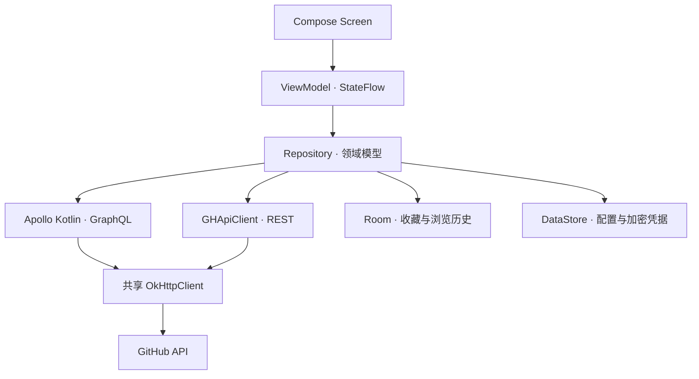
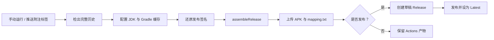

<p align="center">
  
</p>

<h1 align="center">GitMob</h1>

<p align="center">
  <strong>在 Android 上浏览代码、参与协作、管理你的 GitHub。</strong>
</p>

<p align="center">
  使用 Kotlin 与 Jetpack Compose 构建的第三方 GitHub 客户端。<br />
</p>

<p align="center">
  <a href="https://developer.android.com"></a>
  <a href="https://kotlinlang.org"></a>
  <a href="https://developer.android.com/compose"></a>
  <a href="https://m3.material.io"></a>
  <a href="https://www.apollographql.com/docs/kotlin"></a>
  <a href="https://docs.github.com/en/graphql"></a>
</p>

<p align="center">
  <a href="https://github.com/xiaobaiweinuli/GitMob-Android/actions/workflows/build-apk.yml"></a>
  <a href="https://github.com/xiaobaiweinuli/GitMob-Android/releases"></a>
  <a href="https://github.com/xiaobaiweinuli/GitMob-Android/releases"></a>
  <a href="https://github.com/xiaobaiweinuli/GitMob-Android/stargazers"></a>
  <a href="https://github.com/xiaobaiweinuli/GitMob-Android/issues"></a>
</p>

<p align="center">
  <a href="https://github.com/xiaobaiweinuli/GitMob-Android/releases">下载</a> ·
  <a href="#features">功能</a> ·
  <a href="#architecture">架构</a> ·
  <a href="#build">本地构建</a> ·
  <a href="#github-actions">GitHub 配置</a> ·
  <a href="https://github.com/xiaobaiweinuli/GitMob-Android/issues">反馈问题</a>
</p>

> 构建版本以 `APP_VERSION_NAME` 为准，功能可能与已有发行版不同。GitMob 是第三方客户端，与 GitHub 官方无隶属关系。

<a id="features"></a>

## ✨ 功能

| 模块               | 能力                                                    |
| ---------------- | ----------------------------------------------------- |
| 🔐 账号与登录         | Personal Access Token 登录、OAuth 设备授权、多账号添加与切换、当前账号资料编辑 |
| 👤 用户与组织         | 用户及组织主页、关注与取消关注、关注者和关注列表、组织成员、仓库与星标列表                 |
| 📦 仓库            | 列表与筛选、创建仓库、详情与 README、Star、Fork、订阅、分享，以及按权限开放的仓库设置    |
| 🌿 代码与分支         | 目录与文件浏览、文件编辑和提交、分支创建与管理、提交历史、Diff、Fork 同步、文件及归档下载     |
| 🐛 Issues        | 列表、筛选与详情，模板和 Issue Forms，创建、编辑、评论、关闭、重新打开及订阅          |
| 🔀 Pull Requests | 创建与编辑、评论、提交 Review、请求审核、线程回复与解决、草稿切换、更新分支、合并及自动合并设置   |
| 💬 Discussions   | 分类、创建与编辑、评论和回复、答案标记、标签、关闭与重新打开、订阅                     |
| ⚙️ Actions       | 工作流与运行详情、手动触发及输入参数、取消、重新运行、删除运行、启停工作流、产物下载            |
| 🚀 Releases      | 发布列表与详情、创建和编辑、生成发布说明、上传及管理附件、下载资源                     |
| 📝 Gist          | 公开与私密 Gist、创建与编辑、文件管理、评论、Star、Fork、修订历史和版本比较          |
| ⭐ 星标与收藏          | GitHub 星标仓库及 Lists 管理、本地收藏分组、收藏排序、仓库与 Gist 浏览历史       |
| 🔎 搜索与工作事项       | 仓库、代码、Issues、PR、用户和组织搜索；个人 Issues、PR 和 Discussions 列表 |
| 📬 通知            | 通知列表、跳转相关内容、单条及全部标记已读                                 |
| 🌐 翻译与语言         | 内容翻译、双语展示、翻译服务配置；简体中文、繁体中文、英文及跟随系统语言                  |
| 🎨 外观与辅助         | 浅色、深色和跟随系统主题，壁纸及自定义主题色，GitHub / Gist 深链接，应用更新检查       |

写操作是否可用取决于账号权限、Token 授权、仓库状态和对应功能是否开启。其他用户的 Gist 页面仅查询公开内容；私密 Gist 需要使用有权访问的账号。

本地收藏与浏览历史存储在设备上，并按账号管理；GitHub Stars / Lists 属于远端数据，两者分别管理。

<a id="getting-started"></a>

## 📲 下载与登录

1. 在 [Releases](https://github.com/xiaobaiweinuli/GitMob-Android/releases) 中查看发行说明并下载 APK。系统要求为 **Android 8.0 / API 26 及以上**。
2. 首次启动时选择 OAuth 设备授权，按页面提示在浏览器中完成授权；也可以输入自己的 Personal Access Token。
3. 在设置中管理账号、语言与外观，在高级设置中配置收藏、历史记录、翻译和应用更新。

OAuth 设备授权当前请求的 scopes 为：

```text
repo user gist read:org notifications delete_repo workflow
```

具体范围定义在 [GitHubOAuthClient.kt](app/src/main/kotlin/com/gitmob/app/core/auth/GitHubOAuthClient.kt)。Token 登录后的可用功能取决于该 Token 的实际授权范围。

访问 GitHub / Gist 链接时，系统是否直接打开 GitMob 取决于设备的默认链接设置。应用统一解析支持的仓库、文件、Issue、PR、讨论、提交、Release 和 Gist 链接，不支持的链接交给浏览器。

内容翻译默认关闭，可选择 Edge、Transmart、百度、有道开放平台或自定义接口。需要凭据的服务在应用内配置，服务请求与可用性由所选提供方决定。

<a id="stack"></a>

## 🧰 技术栈

版本以 [libs.versions.toml](gradle/libs.versions.toml)、[应用构建脚本](app/build.gradle.kts) 和 [Gradle Wrapper](gradle/wrapper/gradle-wrapper.properties) 为准。

| 分类          | 技术                                              | 当前配置                   |
| ----------- | ----------------------------------------------- | ---------------------- |
| 语言          | Kotlin                                          | `2.4.10`               |
| 构建          | Android Gradle Plugin / Gradle                  | `9.3.1` / `9.6.1`      |
| 代码生成        | KSP                                             | `2.3.10`               |
| Android SDK | 最低 / 目标 / 编译 API                                | `26` / `36` / `37`     |
| Java        | JDK                                             | `21`                   |
| 声明式 UI      | Jetpack Compose BOM                             | `2026.06.01`           |
| 设计系统        | Material 3 / MaterialKolor                      | `1.4.0` / `4.0.0`      |
| 导航          | Navigation 3                                    | `1.1.4`                |
| 依赖注入        | Hilt                                            | `2.60.1`               |
| 异步          | Kotlin Coroutines + Flow / StateFlow            | `1.11.0`               |
| GraphQL     | Apollo Kotlin                                   | `4.4.3`                |
| HTTP        | OkHttp                                          | `5.0.0`                |
| REST JSON   | kotlinx.serialization                           | `1.11.0`               |
| 本地数据库       | Room                                            | `2.7.0`                |
| 偏好设置        | DataStore                                       | `1.1.2`                |
| 图片加载        | Coil                                            | `3.4.0`                |
| Markdown    | CommonMark + GFM 扩展                             | `0.29.0`               |
| 辅助测试        | JUnit 4、MockK、Turbine、MockWebServer、Robolectric | 版本由 Version Catalog 管理 |

<a id="architecture"></a>

## 🏗️ 架构

项目采用单 `app` 模块、按业务目录划分的 **MVVM + Repository** 架构。Compose 页面通过 ViewModel 消费状态与发出操作，Repository 负责数据访问、模型转换和业务数据组合。



- **网络分工**：GraphQL 查询及 Mutation 保存在独立 `.graphql` 文件中，由 Apollo 生成类型；REST 通过 `GHApiClient` 请求并使用 kotlinx.serialization 解码。两条通道共享 OkHttp，分别处理请求头。
- **模型边界**：Repository 将网络数据转换为 `data/model` 中的领域模型，UI 消费业务状态。
- **权限控制**：仓库角色通过 `RepoPermission` / `RepoCapabilities` 派生操作能力，并结合归档状态和 API 返回的操作权限控制入口。
- **账号会话**：`AccountSession` 统一管理账号上下文；凭据通过 Android Keystore 的 AES-256-GCM 加密，由 DataStore 保存密文。
- **公共能力**：Hilt 负责依赖注入；`ApiResult`、`ErrorEventBus` 和 `ErrorBannerHost` 统一错误处理；`PageSize` 集中维护请求容量。
- **导航与内容**：Navigation 3 管理类型化路由；`DeepLinkActivity` 统一接收外部链接；公共 Markdown 渲染能力供 README、评论等内容使用。

### 目录结构

```text
GitMob-Android/
├── .github/workflows/
│   └── build-apk.yml           # APK 签名、构建与 Release 发布
├── app/
│   ├── build.gradle.kts        # SDK、版本、签名和依赖
│   ├── proguard-rules.pro      # Release 混淆规则
│   └── src/
│       ├── main/
│       │   ├── AndroidManifest.xml
│       │   ├── graphql/
│       │   │   ├── schema.graphqls
│       │   │   └── com/gitmob/app/  # 按业务组织的 GraphQL 文档
│       │   ├── kotlin/com/gitmob/app/
│       │   │   ├── core/       # 网络、认证、权限、错误、DI、Markdown 等
│       │   │   ├── data/
│       │   │   │   ├── local/       # Room、搜索历史与本地数据访问
│       │   │   │   ├── model/       # 领域模型与数据结构
│       │   │   │   ├── repository/  # 业务数据访问
│       │   │   │   └── translation/ # 翻译服务与配置
│       │   │   ├── navigation/ # 路由、返回栈与深链接
│       │   │   └── ui/         # 按功能组织的 Screen / ViewModel
│       │   └── res/            # 图片、图标及中英文字符串
│       ├── release/            # Release 专用资源
│       └── test/               # JVM / Robolectric 辅助测试
├── gradle/
│   ├── libs.versions.toml      # 依赖与插件版本
│   ├── gradle-daemon-jvm.properties
│   └── wrapper/               # Gradle Wrapper 配置
├── build.gradle.kts
├── settings.gradle.kts
└── gradle.properties           # APP_VERSION_NAME 等项目属性
```

主要源码入口：[导航](app/src/main/kotlin/com/gitmob/app/navigation/GitMobNavGraph.kt) · [网络配置](app/src/main/kotlin/com/gitmob/app/core/di/NetworkModule.kt) · [权限模型](app/src/main/kotlin/com/gitmob/app/core/permission/RepoPermission.kt) · [Token 存储](app/src/main/kotlin/com/gitmob/app/core/auth/TokenStorage.kt) · [本地收藏与历史](app/src/main/kotlin/com/gitmob/app/data/local/library/LibraryRepository.kt)。

<a id="build"></a>

## 🛠️ 本地构建

### 环境准备

- Git，并保留完整提交历史：`versionCode` 由 `git rev-list --count HEAD` 生成。
- JDK 21。
- Android SDK Platform 37，以及构建所需的 SDK 工具。
- 使用仓库自带的 Gradle Wrapper；也可以在支持当前 AGP 的 Android Studio 中打开根目录并同步。

### 获取源码与配置 SDK

```bash
git clone https://github.com/xiaobaiweinuli/GitMob-Android.git
cd GitMob-Android
```

在未被版本控制的 `local.properties` 中设置自己的 SDK 路径。例如：

```properties
# Windows 示例；请替换为本机路径
sdk.dir=D:/Android/Sdk
```

macOS / Linux 同样填写本机 SDK 的绝对路径。Android Studio 也可以生成此文件。

### Debug APK

Windows PowerShell：

```powershell
.\gradlew.bat :app:assembleDebug
```

macOS / Linux：

```bash
chmod +x gradlew
./gradlew :app:assembleDebug
```

输出为 `app/build/outputs/apk/debug/app-debug.apk`。Debug 包名是 `com.gitmob.app.debug`，Release 包名是 `com.gitmob.app`。

### Release APK 与签名

```powershell
# Windows PowerShell
.\gradlew.bat :app:assembleRelease
```

```bash
# macOS / Linux
./gradlew :app:assembleRelease
```

输出为 `app/build/outputs/apk/release/app-release.apk`。Release 已启用 R8 混淆和资源压缩。

正式签名前，在构建进程的环境中完整提供以下四项：

| 环境变量                        | 内容     |
| --------------------------- | ------ |
| `RELEASE_KEYSTORE_PATH`     | 签名文件路径 |
| `RELEASE_KEYSTORE_PASSWORD` | 签名文件密码 |
| `RELEASE_KEY_ALIAS`         | 密钥别名   |
| `RELEASE_KEY_PASSWORD`      | 密钥密码   |

全部未设置时，本地 Release 构建使用 Debug 签名；仅设置部分变量会导致构建失败。需要发布可持续覆盖安装的版本时，应始终使用同一份正式签名。签名文件和本机配置不提交到仓库。

### 版本来源

| 字段            | 来源                                                                                   |
| ------------- | ------------------------------------------------------------------------------------ |
| `versionName` | [gradle.properties](gradle.properties) 中的 `APP_VERSION_NAME`，格式为 `major.minor.patch` |
| `versionCode` | 当前完整 Git 历史的提交数量                                                                     |
| 标签构建版本        | 工作流去掉标签前缀 `v`，通过 `-PAPP_VERSION_NAME=...` 覆盖                                         |

例如，可用 `-PAPP_VERSION_NAME=0.1.1` 临时指定构建版本；提升版本名本身不会增加 `versionCode`。

<a id="github-actions"></a>

## ⚙️ GitHub Actions 配置与发布

工作流：[Build GitMob APK](.github/workflows/build-apk.yml)。

### Secrets 与 Variables

在仓库的 **Settings → Secrets and variables → Actions** 中配置：

| 名称                  | 类型       | 必填  | 作用                    |
| ------------------- | -------- | --- | --------------------- |
| `KEYSTORE_BASE64`   | Secret   | 是   | 发布签名文件完整内容的 Base64 编码 |
| `KEYSTORE_PASSWORD` | Secret   | 是   | 签名文件密码                |
| `KEY_PASSWORD`      | Secret   | 是   | 签名密钥密码                |
| `KEY_ALIAS`         | Variable | 是   | 签名密钥别名                |

已有签名文件时，可以在 Windows PowerShell 中生成 Base64 并复制到剪贴板，然后粘贴到 `KEYSTORE_BASE64`：

```powershell
[Convert]::ToBase64String([IO.File]::ReadAllBytes((Resolve-Path 'gitmob-release.jks').Path)) | Set-Clipboard
```

`gitmob-release.jks` 是示例文件名，请替换为自己的签名文件。Base64 只是编码，内容仍按签名文件保管。

其他配置的来源如下，无需把它们重复创建为同名仓库 Secret：

| 名称                                                    | 来源与用途                                                   |
| ----------------------------------------------------- | ------------------------------------------------------- |
| `${{ github.token }}`                                 | GitHub 自动提供，工作流将其作为 `GH_TOKEN` 交给 GitHub CLI 发布 Release |
| `RELEASE_KEYSTORE_PATH`                               | 工作流生成的临时文件路径                                            |
| `APP_VERSION_NAME`                                    | Gradle 属性，标签构建时由工作流覆盖                                   |
| `publish_release` / `release_title` / `release_notes` | 手动运行工作流时填写的输入参数                                         |
| `GITHUB_CLIENT_ID`                                    | 当前定义在源码中的 OAuth Client ID，尚未通过 Actions Variable 注入      |

工作流声明了 `contents: write` 权限用于发布 Release。配置方式可参考 GitHub 官方的 [Secrets 文档](https://docs.github.com/en/actions/how-tos/write-workflows/choose-what-workflows-do/use-secrets) 和 [Variables 文档](https://docs.github.com/en/actions/how-tos/write-workflows/choose-what-workflows-do/store-information-in-variables)。

### 手动运行

打开 **Actions → Build GitMob APK → Run workflow**，选择构建分支：

| 输入参数              | 默认值     | 说明                                    |
| ----------------- | ------- | ------------------------------------- |
| `publish_release` | `false` | 关闭时仅上传构建产物；开启时发布正式 Release 并设为 Latest |
| `release_title`   | 空       | 发布时必填，用作 Release 标题                   |
| `release_notes`   | 空       | 发布说明，支持 Markdown；可用字面量 `\n` 分隔多行      |

手动选择分支构建时使用该分支的 `APP_VERSION_NAME`。发布前确认该版本尚无 Release，并检查同名标签（如已存在）是否指向预期提交；当前流程使用 `gh release create`，不会覆盖已有 Release。手动选择标签时，版本名仍按标签取值。

### 通过标签发布

推送符合 `vX.Y.Z` 的**附注标签**会触发构建并发布。标题取自标签注释第一段，正文取自其余内容；轻量标签不满足工作流的标签检查。

以下以 `v0.1.1` 为示例，实际发布时替换为准备发布的版本：

```bash
git tag -a v0.1.1 -m "GitMob 0.1.1" -m "本次更新说明，支持 Markdown。"
git push origin v0.1.1
```

### 工作流与产物



| 项目         | 当前行为                                      |
| ---------- | ----------------------------------------- |
| Runner     | Ubuntu 24.04，任务超时 45 分钟                   |
| Java       | JDK 21                                    |
| APK 文件名    | `GitMob-v{versionName}-{versionCode}.apk` |
| APK 产物保留   | 14 天                                      |
| R8 映射文件保留  | 30 天                                      |
| Release 附件 | 通用 Release APK                            |
| 签名文件清理     | 任务结束时清理临时签名文件                             |
| 自动触发范围     | `v*` 标签推送；普通分支 push 和 PR 不触发              |
| 测试         | 当前工作流执行构建与发布，未配置测试或独立 lint 步骤             |

顶部 APK 徽章展示该工作流的状态；尚无可用运行记录时可能显示 `no status`。技术栈徽章是当前配置的静态说明，Release、下载量、Stars 和 Issues 徽章从远端仓库动态获取。

<a id="updates"></a>

## 🔄 应用更新与 Fork 配置

应用更新通过公共 GitHub Release 接口查询 `xiaobaiweinuli/GitMob-Android` 的 Latest Release，并按下面的约定识别 APK：

- Release 为正式版本，不是草稿或预发布。
- APK 文件名符合 `GitMob-v{major.minor.patch}-{versionCode}.apk`。
- Release 标签与文件中的版本名一致，格式为 `v{major.minor.patch}`。
- Release 中有且仅有一个满足校验条件的 APK；其 `versionCode` 高于已安装版本时才提示更新。

更新说明通过 Markdown 渲染。下载交给外部浏览器，由浏览器处理下载及后续安装入口。

如果 Fork 后独立发行自己的版本，需要同步检查以下位置：

| 位置                                                                                                  | 需要调整的内容                           |
| --------------------------------------------------------------------------------------------------- | --------------------------------- |
| [AppUpdateRepository.kt](app/src/main/kotlin/com/gitmob/app/data/repository/AppUpdateRepository.kt) | 更新源仓库；若更改 APK 命名，也需同步修改解析规则       |
| [.github/workflows/build-apk.yml](.github/workflows/build-apk.yml)                                  | 产物命名与自己的发布配置，保持与应用更新逻辑一致          |
| [GitHubOAuthClient.kt](app/src/main/kotlin/com/gitmob/app/core/auth/GitHubOAuthClient.kt)           | 自己的 OAuth Client ID，以及对应应用的设备授权配置 |
| [AboutScreen.kt](app/src/main/kotlin/com/gitmob/app/ui/settings/AboutScreen.kt)                     | 开发者、项目地址和关于页信息                    |
| [app/build.gradle.kts](app/build.gradle.kts)                                                        | 根据发行需求检查包名、版本和签名                  |
| 本 README                                                                                            | 仓库链接、徽章、下载入口和项目说明                 |

<a id="testing"></a>

## 🧪 测试与开发

现有辅助测试覆盖网络、Repository、ViewModel、导航、权限和部分 Compose UI，主要位于 [app/src/test](app/src/test)。

Windows PowerShell：

```powershell
.\gradlew.bat :app:testDebugUnitTest
```

macOS / Linux：

```bash
./gradlew :app:testDebugUnitTest
```

HTML 测试报告位于 `app/build/reports/tests/testDebugUnitTest/index.html`。上述是运行方式，不代表当前分支已经通过所有测试；构建徽章也不代表测试结果。

涉及页面交互、账号切换、深链接或实际 API 行为的改动，还需要在模拟器或设备上安装对应 APK 并验证相关流程。

开发时保持以下约定：

- 页面通过 ViewModel 访问业务状态，网络操作放在 Repository 或对应基础服务中。
- GraphQL 文档放入所属业务目录，网络数据转换为领域模型后提供给上层。
- 仓库管理入口复用统一权限模型，错误提示复用公共错误通道。
- 用户可见文案同步维护 `values`、`values-en` 与 `values-zh-rTW` 三套资源。
- 为业务逻辑改动补充相应回归验证，并保留与实现一致的文档。

<a id="limitations"></a>

## 📌 当前边界

- **服务范围**：默认 API 地址为 GitHub.com；当前没有 GitHub Enterprise Server 的可配置登录入口。
- **网络与权限**：远端操作受 GitHub API、Token 权限、仓库规则和限流约束；本地收藏与历史不代表完整离线仓库支持。
- **外部链接**：应用声明了 GitHub / Gist 链接入口，实际默认打开方式由系统设置决定。
- **编辑器实现**：Version Catalog 中预留的 Sora Editor、AppIconLoader、ParcelableList 尚未作为实际功能依赖接入，不计入现有功能。
- **许可证状态**：关于页当前显示 Apache 2.0，但本仓库尚未包含对应的 `LICENSE` 文件，许可证信息有待补齐。

<a id="feedback"></a>

## 🤝 反馈

遇到问题时，欢迎提交 [Issue](https://github.com/xiaobaiweinuli/GitMob-Android/issues)，附上应用版本、Android 版本、复现步骤和相关截图。日志与截图请先移除 Token、密码和其他私密信息。
